<picture>
  <source media="(prefers-color-scheme: dark)" srcset="assets/header-dark.svg">
  
</picture>

  

 

Friends sit next to each other and everyone scrolls alone. **Pyk** turns that into a game in ten seconds: phones with the app open detect each other over Bluetooth LE — no accounts, no room codes, no lobby. Swipe through game cards together, and the first game you both like starts right away. Server-side Elo, party mode for up to 8 over a QR code, and a bot to practice with when nobody's around.

**[Get Pyk on Google Play →](https://play.google.com/store/apps/details?id=com.oskarsledz.pyk)**

 

### Also shipped

[**Motivio**](https://play.google.com/store/apps/details?id=com.oski3k.motivio) — habits, mood, journaling, breathing &nbsp;`Flutter` `Firebase` 
[**BodyLog**](https://play.google.com/store/apps/details?id=com.oski3k.body_log) — body measurements and progress &nbsp;`Flutter` `Firebase` 
[**oskarsledz.pl**](https://github.com/oski3k/portfolio) — fast, SEO-tuned portfolio &nbsp;`React` `Vite` `Tailwind`

 

### Toolbox

<picture>
  <source media="(prefers-color-scheme: dark)" srcset="https://skillicons.dev/icons?i=flutter%2Cdart%2Ckotlin%2Creact%2Cts%2Cvite%2Ctailwind%2Csupabase%2Cpostgres%2Cfirebase%2Cnodejs%2Cpython&theme=dark&perline=12">
  
</picture>

  

Off screen: triathlon training · drone footage · 3D printing

[oskarsledz.pl](https://oskarsledz.pl) · [LinkedIn](https://www.linkedin.com/in/oskarsledz/) · [X](https://x.com/devoskarsledz) · [hello@oskarsledz.pl](mailto:hello@oskarsledz.pl)
